

  
  <h1>Finora — Shared Financial Space</h1>
  
<strong>Manage household budgets together while keeping your personal spending completely private.</strong>

---

## What Is Finora?

Managing money in a shared home shouldn't mean giving up personal privacy—or maintaining messy spreadsheets. **Finora** is a mobile-first household finance app built for couples, families, and roommates who want clarity on shared expenses without exposing every personal purchase.

### Built Around Three Core Promises

- **🤝 Shared Household Budgets:** Track joint costs like rent, groceries, utilities, and household pool contributions in one shared space.
- **🔒 Private Personal Freedom:** Your personal expenses, private cards, and personal income are strictly visible only to you unless you choose to share them.
- **📊 Clear Monthly Insights:** See who contributed how much, browse monthly spending by category, and keep manual account balances up to date.

---

## Tech Stack & Integrations

| Layer | Technology & Role |
| :--- | :--- |
| **Mobile App** | **Expo (SDK 58)**, **React Native**, **TypeScript**, **Expo Router**, **react-native-svg** (custom interactive donut charts, radial gauges & brand emblem), built for Android via **EAS Build** |
| **Backend & Database** | **Supabase** (PostgreSQL, Row-Level Security policies for personal/household isolation, server-side SQL RPCs for monthly summaries, one-time invite tokens & account deletion) |
| **Google Login** | **Google OAuth** via Supabase Auth, **expo-auth-session**, and **expo-web-browser** with PKCE verification and native deep-link redirect (`household-finance://auth`) |
| **Product Analytics** | **PostHog** (privacy-first screen and lifecycle tracking that strips all amounts, balances, notes, emails, and tokens before capture) |

---

## End-to-End User Journey

<table>
  <tr>
    <td align="center"><strong>1. Splash Screen</strong> 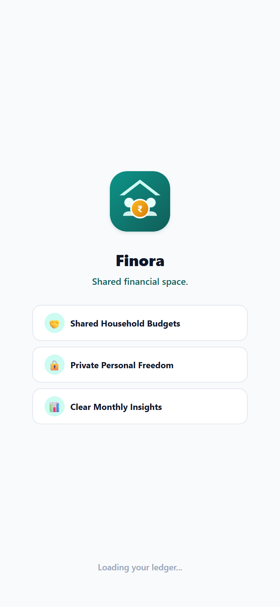</td>
    <td align="center"><strong>2. Sign In / Google Login</strong> 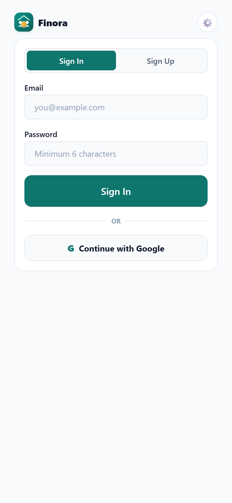</td>
    <td align="center"><strong>3. Create or Join Household</strong> 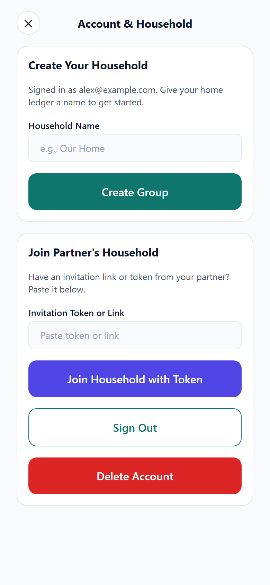</td>
  </tr>
  <tr>
    <td align="center"><strong>4. Home &amp; Contribution Chart</strong> 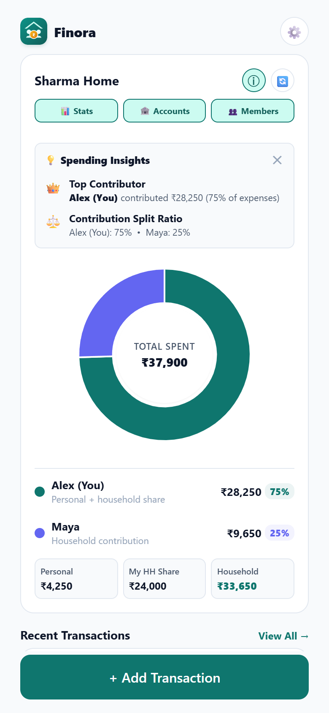</td>
    <td align="center"><strong>5. Add Transaction</strong> 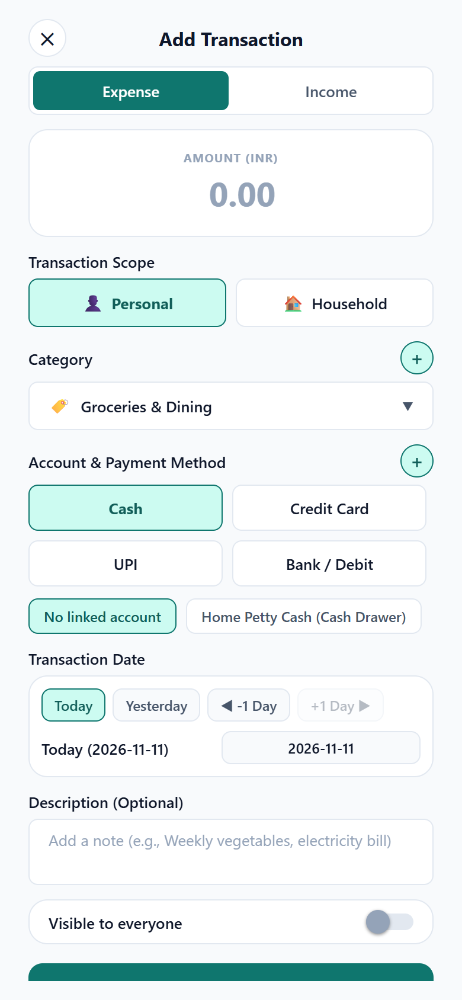</td>
    <td align="center"><strong>6. Monthly Stats (Personal)</strong> 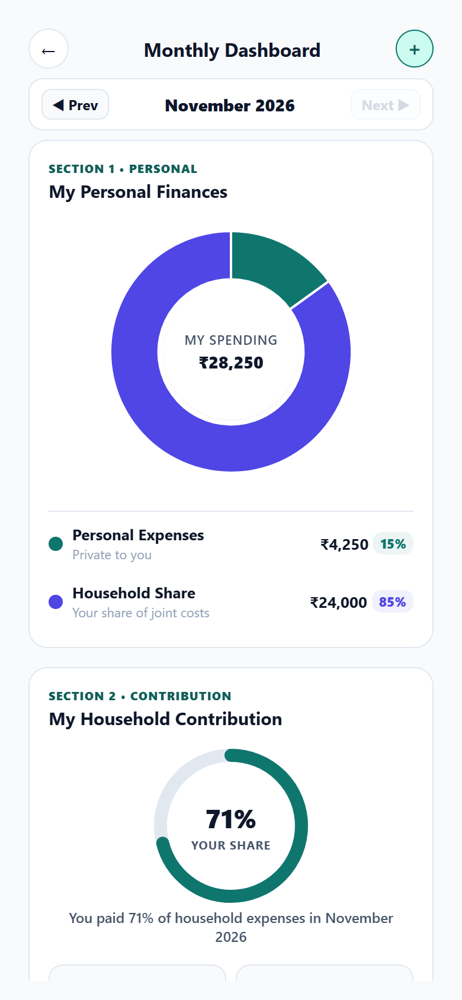</td>
  </tr>
  <tr>
    <td align="center"><strong>7. Monthly Stats (Categories)</strong> 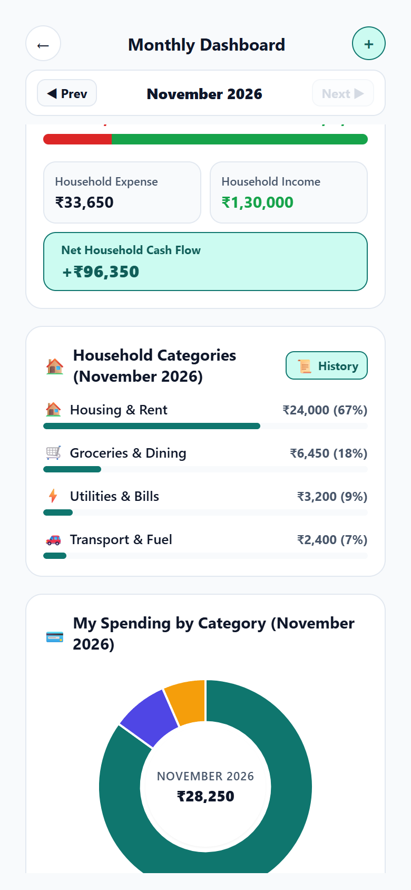</td>
    <td align="center"><strong>8. Transaction History</strong> 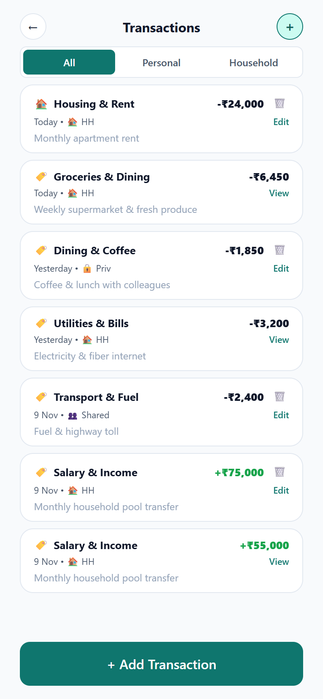</td>
    <td align="center"><strong>9. Accounts &amp; Balances</strong> 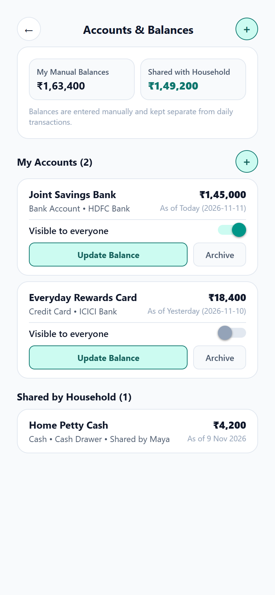</td>
  </tr>
  <tr>
    <td align="center"><strong>10. Members &amp; Invites</strong> 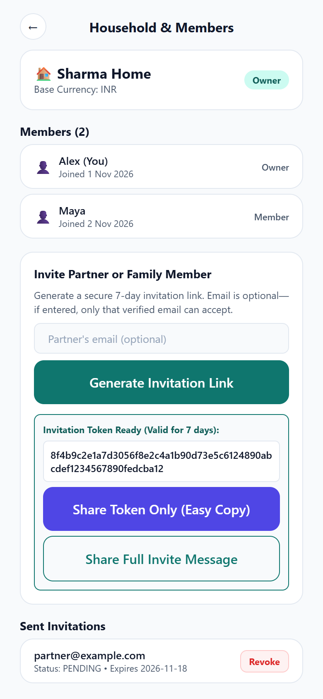</td>
    <td align="center"><strong>11. Profile &amp; Settings</strong> 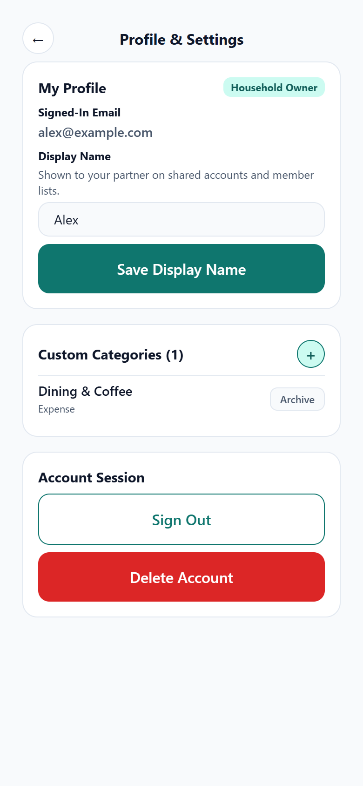</td>
    <td></td>
  </tr>
</table>

---

## How Privacy Works in Finora

| Scope / Setting | Who Can See It? | Where Does It Count? |
| :--- | :--- | :--- |
| **Personal (Private — Default)** | Only you | Your personal totals only (hidden from partners) |
| **Personal (Visible to Everyone)** | All household members | Shared visibility while tagged as personal |
| **Household** | All household members | Joint household totals, contribution charts & monthly cash flow |

---

## MVP Validation & Key Metrics

Finora's MVP tests one core hypothesis: **households adopt collaborative budgeting when joining together is effortless and personal finances stay private by default.** The metrics below connect directly to our **Supabase** database records and privacy-safe **PostHog** events:

| Metric | How It Is Measured | Why It Matters (Logic) |
| :--- | :--- | :--- |
| **Activation Rate** | `auth_signed_up` / `auth_signed_in` → `household_created` or invite accepted | Confirms friction-free onboarding (Email or Google Login) translates into an active home ledger rather than drop-off at setup. |
| **Multi-Member Household Rate** | % of active households with 2+ members (`household_members`) | Shared finance only delivers value when partners join; tracks whether the one-time invite flow succeeds end to end. |
| **Logging Habit & Scope Split** | Weekly `transaction_created` events per household + Personal vs. Household ratio | Validates recurring utility and proves users actively use *both* private personal logging and joint household tracking—our core differentiator. |
| **Insight Engagement** | `$screen` views on `/dashboard` (Monthly Stats) and Home chart usage | Confirms users come back to review contribution splits and category breakdowns, not just log raw numbers. |
| **Trust & Retention** | 4-week active household retention vs. `auth_account_deleted` | Ensures households keep using Finora month-over-month while retaining full control over their account and privacy. |
